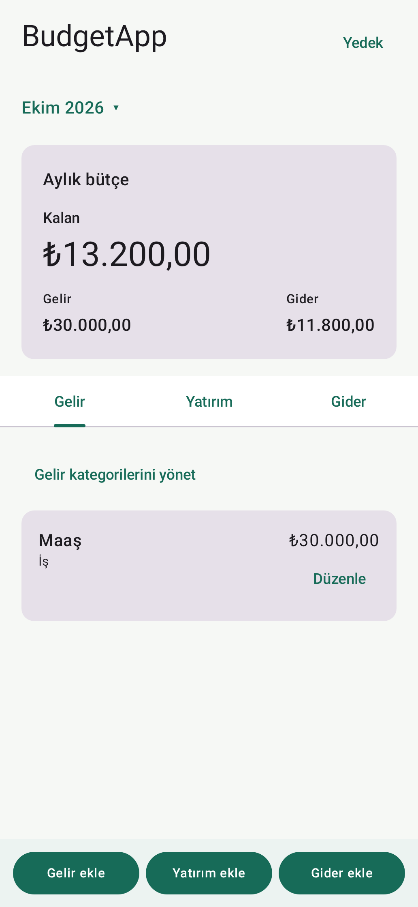
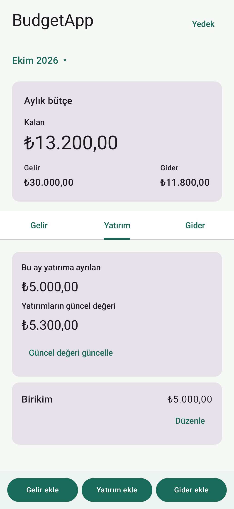
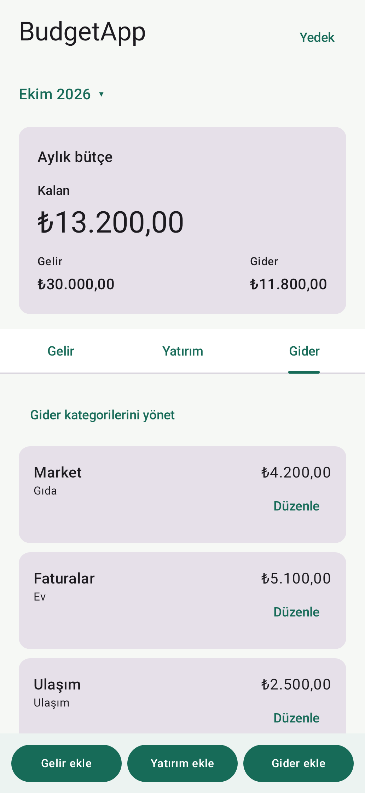
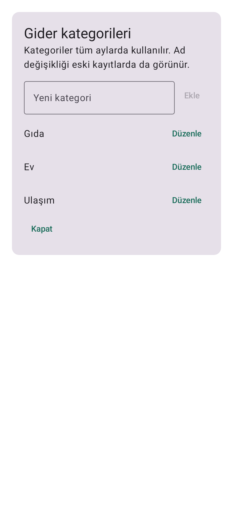
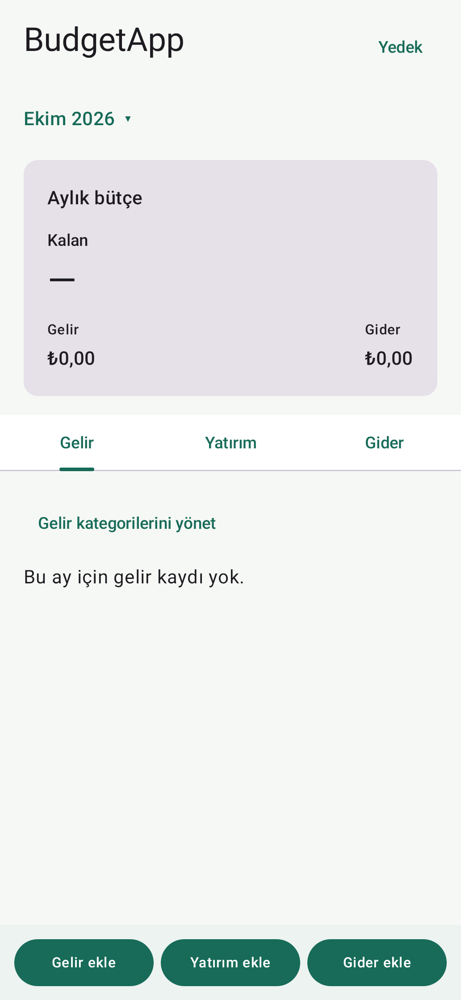

# BudgetApp

Hesap gerektirmeyen, Android için yerel bütçe uygulaması. Gelir, gider ve
yatırıma ayrılan tutarlar aylara göre telefonun yerel SQLite veritabanına
kaydedilir. **Kalan = gelir − gider − yatırıma ayrılan tutar.** Yatırımların
aylık toplam güncel değeri ayrıca girilir ve Kalan hesabını değiştirmez.
Gelir ve gider kategorilerini kendin oluşturup yeniden adlandırabilirsin;
kategoriler tüm aylarda ortaktır. Ad değişikliği eski kayıtlara da yansır.
Otomatik Android yedekleme ve cihazdan cihaza aktarım kapalıdır. Üstteki
**Yedek** düğmesiyle en az sekiz karakterlik parola kullanarak şifreli tek
dosya oluşturulabilir. Geri yükleme dosyayı ve parolayı doğruladıktan sonra
mevcut kayıtların tamamını değiştirir. Bu akış gerçek telefonda henüz
denenmediği için geliştirme sürümüne önemli kişisel veriler girilmemelidir.
Güncel aşamalar ve kararlar [ROADMAP.md](ROADMAP.md) dosyasındadır.

## Tarayıcıdan ekran ön izlemesi

Android Studio kurmadan GitHub'da şu beş görüntüyü açabilirsin:

- [Örnek bütçe ekranı](docs/previews/sample-budget.png)
- [Yatırım bölümü](docs/previews/investment-budget.png)
- [Gider bölümü](docs/previews/expense-budget.png)
- [Gider kategorilerini yönetme](docs/previews/category-manager.png)
- [Boş bütçe ekranı](docs/previews/empty-budget.png)

Bu görüntüler Android uygulamasının Compose ekranından üretilir. Yalnızca
görsel ön izlemedir; tıklanabilir uygulama veya web uygulaması değildir.
Örnek rakamlar telefona kaydedilmez. Gerçek APK'da aya dokunarak geçmiş ayı
seçebilir, bölümleri sağa sola kaydırabilir ve alttaki düğmelerle kayıt
ekleyebilirsin.
Gelir ve Gider bölümlerindeki **kategorilerini yönet** düğmesiyle kategori
ekleyebilir veya adını değiştirebilirsin. Yeni kayıtta kategoriyi seçebilirsin.
Bir kayıttaki **Düzenle** düğmesi açıklamasını, tutarını ve varsa kategorisini
değiştirir. Aynı penceredeki **Sil** düğmesi ayrıca onay ister. Düzenleme ve
silme gelir, gider ve yatırıma ayrılan tutar kayıtlarında çalışır.
Eski kategorisiz kayıtlar korunur; önceki şifreli yedekler açılabilir.

## Android Studio ile canlı ekran ön izlemesi (isteğe bağlı)

1. [Android Studio](https://developer.android.com/studio) kur. Emülatör
   kurman gerekmiyor.
2. GitHub'daki `codex/android-setup` dalını bilgisayarına indir veya klonla.
   Android Studio'da **File > Open** ile `BudgetApp` klasörünü aç.
3. Android Studio'nun **Gradle Sync** işlemini bitirmesini bekle. İsterse
   Android SDK 36 bileşenlerini kur.
4. `app/src/main/java/com/hmagr/budgetapp/ui/BudgetHomeScreen.kt` dosyasını
   aç. Editörün **Split** veya **Design** görünümünden **Preview** panelini
   açıp **Build & Refresh** düğmesine bas.
5. **Örnek bütçe** ve **Boş bütçe** adlı ekranlar görünür. Örnek bütçedeki
   rakamlar yalnızca tasarımı göstermek içindir; telefona kaydedilmez.

Android Studio uygun bir JDK'yı kendisi sunar. Komut satırından derleme için
JDK 17 veya üzeri ve Android SDK 36 gerekir.

## İlk APK'yı derleme

Android Studio'da **Build > Build APK(s)** seçeneğini kullanabilirsin. Komut
satırında macOS/Linux için `./gradlew :app:assembleDebug`, Windows için
`gradlew.bat :app:assembleDebug` çalıştır. Debug APK şu dosyada oluşur:
`app/build/outputs/apk/debug/app-debug.apk`.

Bu geliştirme APK'sında ay seçimi, gelir/yatırım/gider kaydı, yatırımın
aylık güncel değerini girme, kayıt düzenleme/silme ve şifreli dosyayı
dışa/içe aktarma kodlandı.
Uygulamayı kapatıp açma ve dosyayı başka telefona taşıma akışları gerçek
Android cihazda henüz doğrulanmadı.

## Güncellenebilir APK

GitHub'da otomatik test/derleme ve aynı anahtarla imzalı APK üreten iş
akışları hazırlandı. APK'nın her sürümde aynı uygulamanın üzerine kurulması
için anahtarı kendi bilgisayarında oluşturup GitHub sırlarına eklemelisin.
Adımlar [imza anahtarı yönergesinde](docs/SIGNING.md). Gerçek anahtar Git
deposuna konmaz; sırlar eklenene kadar imzalı APK iş akışı tamamlanamaz.
APK hazır olduğunda [telefon deneme adımları](docs/PHONE_TESTING.md) üzerinden
örnek tutarlarla kayıt, düzeltme ve yedek geri yükleme kontrol edilebilir.

## Ekran görüntülerini yenileme

Ekran kodu değişince Android SDK ve JDK kurulu bilgisayarda
`./gradlew :app:updateDebugScreenshotTest` çalıştır. Üretilen referans
görüntüler `app/src/screenshotTestDebug/reference/` klasöründedir.
Tarayıcıda gösterilen `docs/previews/` kopyalarını da güncelle ve
`./gradlew :app:validateDebugScreenshotTest` ile doğrula.
